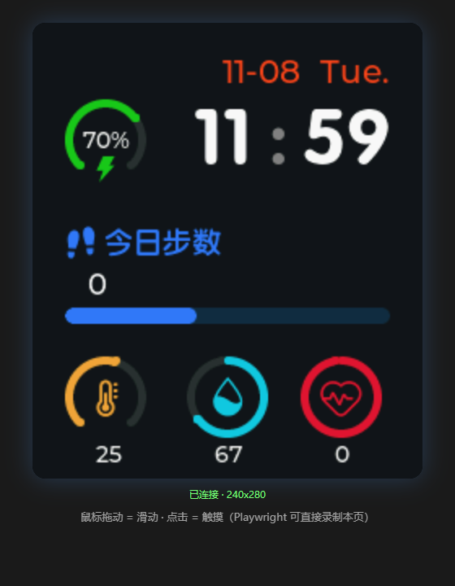
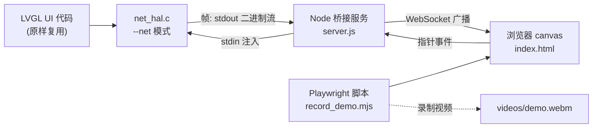

# LVGL Web Bridge

**Run your *native* LVGL simulator in the browser — and drive it with Playwright.**

把**原生** LVGL 模拟器搬进浏览器网页：不改 UI 代码、不需要 Emscripten/WASM 交叉编译，
鼠标点拖即触摸，Playwright 直接编排操作、录视频、做 UI 回归测试。



📺 演示视频（OV-Watch 智能手表模拟器，Playwright 自动操作 + 录制）：
[assets/demo.webm](assets/demo.webm)

---

## ✨ 特性

- **零交叉编译** — 复用你已有的 PC 模拟器工程（gcc/MSVC 编译的原生 exe），
  不需要 emsdk/WASM 工具链（在网络受限环境尤其现实）
- **侵入极小** — 接入只需拷 2 个文件（`net_hal.c/h`）+ 改约 5 行 `main.c`
- **Playwright 全家桶** — 录视频、截图、无头 CI、UI 断言，白嫖浏览器自动化的整个生态
- **按需推帧** — 帧挂在 LVGL `monitor_cb` 钩子上，界面静止时零流量
- **协议极简** — 12 字节帧头 + 5 字节指针事件（[docs/protocol.md](docs/protocol.md)），
  任何语言都能对接
- **任意分辨率** — 页面按帧头自适应，240×280、320×240、480×480 都行

## 🏗️ 架构



## 🚀 快速开始

```bash
# 1. 装依赖（纯 JS，无需下载浏览器，用系统 Edge/Chrome）
cd web && npm install
#   首次安装跳过浏览器下载: PLAYWRIGHT_SKIP_BROWSER_DOWNLOAD=1 npm install

# 2. 指向你的模拟器 exe（需 --net 支持，见下节）并启动
SIM_EXE=/path/to/your/main.exe node server.js

# 3. 打开页面 / 录一段视频
#    浏览器访问 http://127.0.0.1:8090
node record_demo.mjs     # → web/videos/demo.webm
```

## 🔌 接入你自己的 LVGL 模拟器

以 [OV-Watch](https://github.com/No-Chicken/OV-Watch)（LVGL v8.2 SDL 模拟器）为例：

1. 拷贝 `native/net_hal.c`、`native/net_hal.h` 到模拟器工程
2. `main.c` 加分发逻辑：

```c
#include "net_hal.h"

int main(int argc, char **argv) {
    int net_mode = (argc > 1 && strcmp(argv[1], "--net") == 0);
    if (net_mode) net_hal_silence_logs();   /* 必须在 lv_init() 前 */
    lv_init();
    if (net_mode) net_hal_init(WIDTH, HEIGHT);
    else          hal_init();               /* 原 SDL 后端，保持不动 */
    ...
}
```

3. 构建脚本里把 `net_hal.c` 加进源文件列表，重新编译完成

> **两个必踩的坑**（都是实操踩出来的）：
> ① 换掉 SDL 驱动后**没人调 `lv_tick_inc`** 了——原模拟器的 tick 藏在 SDL
> 驱动的内部线程里，net_hal 自带 tick 线程补上；
> ② LVGL `LV_LOG_PRINTF` 会把日志 printf 到 stdout 污染帧流——net_hal
> 用 `_dup`/`_dup2` 把 stdout 改道到 stderr，帧流走独立句柄。

## 🤖 Playwright 自动化

`web/record_demo.mjs` 是一个完整示例：`tap()` / `swipe()` 编排任意操作序列，
`recordVideo` 一开就是产品级演示视频。同理可以：

- `shot.mjs`：截图做基线（golden image）对比
- CI 里 headless 跑关键路径，页面像素/帧数变化即断言
- `page.evaluate` 读 canvas 做自定义校验（参见示例里的签名技巧）

```js
await swipe(30, 150, 210, 150);   // 右滑进菜单
await tap(120, 140);              // 点一个应用
```

## 🌍 和现有方案对比

| 方案 | 跑在哪 | 前置要求 | 自动化/录屏 |
|---|---|---|---|
| [LVGL 官方在线 demo](https://lvgl.io/demos)（WASM） | 浏览器 | 只能看官方 demo | ✗ |
| [lv_sim_emscripten](https://github.com/lvgl/lv_sim_emscripten)（WASM） | 浏览器 | emsdk 交叉编译整个工程 | 自己写 JS 钩子 |
| [Wokwi](https://wokwi.com) | 云端 | 在线工程/订阅制 | API 有限 |
| [InfiniSim](https://github.com/InfiniTimeOrg/InfiniSim) | 桌面 SDL | cmake + SDL | 需自己抓屏 |
| **LVGL Web Bridge（本项目）** | 浏览器 | **只要本机能编译模拟器** | **Playwright 原生支持** |

一句话：WASM 路线把 UI 编译进浏览器，本项目把 UI **串流**进浏览器——
换来的是零工具链成本和完整的浏览器自动化生态。

## ⚠️ 限制

- 目前 C 端线程/管道代码用 Win32 API（`#ifdef _WIN32`），Linux/macOS 需替换为 pthread
- 像素转换按 `LV_COLOR_DEPTH 16`（RGB565）写死，32 位色改一处转换即可
- 指针输入只有单点触摸（无键盘/滚轮/多点，协议预留了扩展空间）
- 服务端广播同一输入流，多客户端共享屏幕而非独立会话

## 🙏 致谢

- [OV-Watch](https://github.com/No-Chicken/OV-Watch) by No-Chicken —
  演示用的 STM32 智能手表开源项目（本项目在其 LVGL v8.2 模拟器上开发验证）
- [LVGL](https://github.com/lvgl/lvgl) v8.2

## License

[GPL-3.0](LICENSE)（与所演示的 OV-Watch 工程一致）
